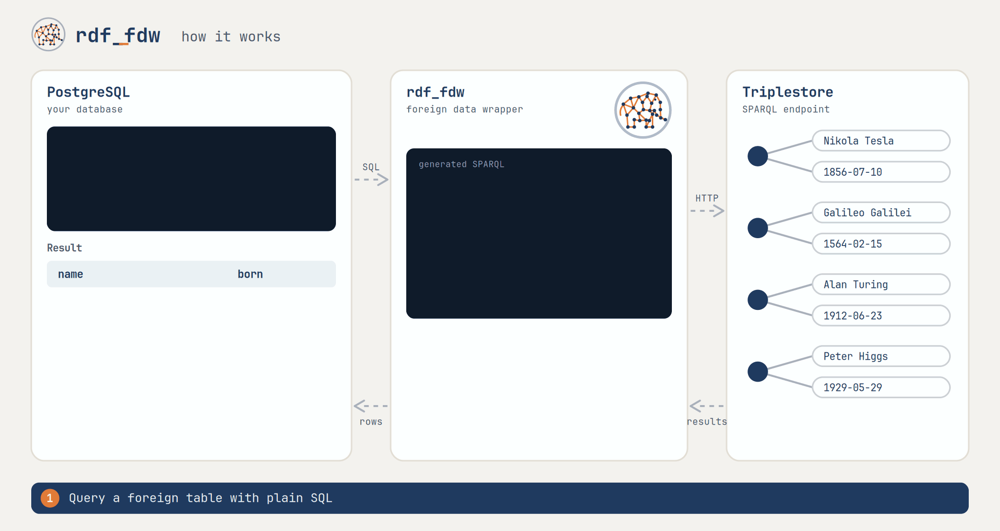

---------------------------------------------
# RDF Triplestore Foreign Data Wrapper for PostgreSQL (rdf_fdw)


`rdf_fdw` is a PostgreSQL Foreign Data Wrapper that enables seamless integration with RDF triplestores via SPARQL endpoints. It supports querying RDF data using SQL, with advanced features including pushdown of SQL clauses (WHERE, LIMIT, ORDER BY, DISTINCT), data modification operations (INSERT, UPDATE, DELETE), and built-in implementations of SPARQL 1.1 functions. The extension introduces a custom `rdfnode` data type for native RDF term handling and provides tools for prefix management, making it easier to work with RDF vocabularies directly from PostgreSQL.

<picture>
  <source media="(prefers-color-scheme: dark)" srcset="misc/img/gif/rdf_fdw-how-it-works-dark@2x.gif">
  
</picture>


## Index

- [Requirements](#requirements)
- [Quick Start](#quick-start)
- [Update Extension](#update-extension)
- [Deploy with Docker](#deploy-with-docker)
- [Usage](#usage)
  - [CREATE SERVER](#create-server)
  - [CREATE USER MAPPING](#create-user-mapping)
  - [CREATE FOREIGN TABLE](#create-foreign-table)
  - [RDF Node Handling](#rdf-node-handling)
    - [Arithmetic](#arithmetic)
    - [Comparing, sorting and grouping](#comparing-sorting-and-grouping)
  - [ALTER FOREIGN TABLE and ALTER SERVER](#alter-foreign-table-and-alter-server)
  - [Pushdown](#pushdown)
  - [Prefix Management](#prefix-management)
  - [Data Modification](#data-modification)
    - [INSERT](#insert)
    - [UPDATE](#update)
    - [DELETE](#delete)
  - [rdf_fdw_version](#rdf_fdw_version)
  - [rdf_fdw_settings](#rdf_fdw_settings)
  - [rdf_fdw_clone_table](#rdf_fdw_clone_table)
  - [EXPLAIN and Diagnostics](#explain-and-diagnostics)
- [SPARQL Functions](#sparql-functions) ([full reference](docs/sparql-functions.md))
- [SPARQL Describe](#sparql-describe)
- [GIS integration](#gis-integration)
- [For testers and developers](#for-testers-and-developers)

## Requirements

* [PostgreSQL](https://www.postgresql.org): version 9.5 or higher.
* [libxml2](http://www.xmlsoft.org/): version 2.5.0 or higher.
* [libcurl](https://curl.se/libcurl/): version 7.74.0 or higher.
* [pkg-config](https://linux.die.net/man/1/pkg-config): pkg-config 0.29.2 or higher.
* [gcc](https://gcc.gnu.org/) and [make](https://www.gnu.org/software/make/) to compile the code.

In an Ubuntu environment you can install all dependencies with the following command:

```shell
apt-get install -y make gcc postgresql-server-dev-18 libxml2-dev libcurl4-gnutls-dev pkg-config
```

> [!NOTE]  
> `postgresql-server-dev-18` only installs the libraries for PostgreSQL 18. Change it if you're using another PostgreSQL version.

## Quick Start

Ensure [pg_config](https://www.postgresql.org/docs/current/app-pgconfig.html) is properly set before running `make`. This executable is typically found in your PostgreSQL installation's `bin` directory.

```bash
$ cd rdf_fdw
$ make
```

After compilation, install the Foreign Data Wrapper:

```bash
$ make install
```

Then, create the extension in PostgreSQL:

```sql
CREATE EXTENSION rdf_fdw;
```

To install a specific version, use:

```sql
CREATE EXTENSION rdf_fdw WITH VERSION '3.1';
```

To run the predefined regression tests: 

```bash
$ make PGUSER=postgres installcheck
```

This runs the tests that need nothing besides a PostgreSQL server. The remaining
groups query triplestores, so they have to be requested explicitly:

| Variable | Adds |
|----------|------|
| `INCLUDE_LOCAL_TESTS=1` | tests against the triplestores deployed by `scripts/postgres-env` (Virtuoso, QLever, Fuseki, GraphDB, and a proxy) |
| `INCLUDE_EXTERNAL_TESTS=1` | tests against public SPARQL endpoints, such as Wikidata and Getty |
| `INCLUDE_STRESS_TESTS=1` | long running stress tests - these need the local deployment as well |
| `INCLUDE_DEBUG_TESTS=1` | tests that check debug output - these need the local deployment as well |
| `INCLUDE_ALL_TESTS=1` | all of the above |

```bash
$ make PGUSER=postgres INCLUDE_LOCAL_TESTS=1 installcheck
```

> [!WARNING]  
> `rdf_fdw` loads all retrieved RDF data into memory before converting it for PostgreSQL. If you expect large data volumes, ensure that PostgreSQL has sufficient memory. When connecting to untrusted or public endpoints, consider setting `max_response_size` on the `SERVER` to cap the response body and prevent runaway allocations.


## Update Extension

To update the extension's version you must first build and install the binaries and then run `ALTER EXTENSION`:

```sql
ALTER EXTENSION rdf_fdw UPDATE;
```

To update to an specific version use `UPDATE TO` and the full version number, e.g.

```sql
ALTER EXTENSION rdf_fdw UPDATE TO '3.1';
```

## Deploy with Docker

A convenient way to build and test `rdf_fdw` is to create a Docker image that bundles the extension with a matching PostgreSQL base image. The two common approaches are:

- Build an image that compiles and installs the extension (reproducible, good for CI).
- Mount the source into a container and run `make install` for iterative development (faster local iterations).

Minimal example Dockerfile for PostgreSQL 18:

```dockerfile
FROM postgres:18

RUN apt-get update && \
    apt-get install -y git make gcc postgresql-server-dev-18 libxml2-dev libcurl4-gnutls-dev pkg-config

RUN git clone --branch v3.1 https://github.com/jimjonesbr/rdf_fdw.git && \
    cd rdf_fdw && \
    make -j && \
    make install
```

Build and run the image:

```bash
docker build -t rdf_fdw:18-3.1 .
docker run -d --name rdf_fdw_container -e POSTGRES_HOST_AUTH_METHOD=trust rdf_fdw:18-3.1
```

Create the extension inside the running container:

```bash
docker exec -u postgres rdf_fdw_container psql -d postgres -c "CREATE EXTENSION rdf_fdw;"
```

To build the latest development version instead of a release, remove `--branch v3.1` from the `git clone` command.

> [!NOTE]
> Do not use `POSTGRES_HOST_AUTH_METHOD=trust` in production. Check for other `POSTGRES_HOST_AUTH_METHOD` in the PostgreSQL docker documentation.


## Usage

Set up a `SERVER` that points to a SPARQL endpoint, then declare `FOREIGN TABLE`s that contain the SPARQL query and map result variables to table columns. Keep foreign-table queries simple to maximise pushdown; see the [Pushdown](#pushdown) section for details and limitations.

### CREATE SERVER

Use `CREATE SERVER` to register a remote SPARQL endpoint with PostgreSQL - the creator becomes the server owner. The `endpoint` option (the SPARQL endpoint URL) is required; you may also specify optional connection settings such as timeouts or proxy parameters, if applicable.

Example: register the DBpedia SPARQL endpoint

```sql
CREATE SERVER dbpedia
FOREIGN DATA WRAPPER rdf_fdw 
OPTIONS (endpoint 'https://dbpedia.org/sparql');
```


**Server Options**

| Server Option | Type | Description |
|---------------|------|-------------|
| `endpoint` | **required** | SPARQL endpoint URL (required). |
| `update_url` | optional | URL used for SPARQL UPDATE requests (`INSERT`, `UPDATE`, `DELETE`) when it differs from `endpoint`, e.g. Fuseki's `/update` service. |
| `batch_size` | optional | Number of rows to accumulate per SPARQL UPDATE request for DML operations (default `50`). Larger batches reduce network overhead but may exceed endpoint limits. A row does not reach the endpoint until its batch is sent, so anything that reads the table back within the same statement — an `AFTER` row trigger, for instance — needs `batch_size '1'` to see it. |
| `enable_pushdown` | optional | Enable translation of SQL clauses into SPARQL (default `true`). |
| `format` | optional | Expected SPARQL result MIME type (default `application/sparql-results+xml`). Set if your endpoint requires a different value. |
| `http_proxy` | optional | HTTP proxy URL (for authentication, specify `proxy_user` and `proxy_password` in `USER MAPPING`). |
| `https_proxy` | optional | Same as `http_proxy`, but the connection to the proxy itself is made over TLS. Set one or the other, not both. |
| `connect_timeout` | optional | Connection timeout in seconds (default `300`). |
| `request_timeout` | optional | Maximum time in seconds allowed for a complete HTTP request (connect + transfer). `0` disables the limit (default). Unlike `connect_timeout`, this applies to the entire duration of the request, including data transfer. |
| `connect_retry` | optional | Number of times a request is retried when it gets no response at all, e.g. when the connection fails, or when the endpoint answers HTTP `429`, `502` or `503` to ask to come back later (default `3`). Other HTTP errors are not retried, nor is a proxy refusing the connection with a client error such as `407`. The wait between attempts is what the endpoint asks for in its `Retry-After` header; otherwise it starts at 1 second after a network error and at 5 seconds after an HTTP answer, and doubles each time. A single wait is at most 300 seconds. Modifications are retried as well, which is safe because rdf_fdw only sends `INSERT DATA` and `DELETE DATA`. |
| `request_max_redirect` | optional | Maximum number of HTTP redirects to follow (default `0`). `0` refuses any redirect; any higher value enables redirection and caps it at that many hops. Credentials are never forwarded to a redirected host. |
| `request_redirect` | *deprecated* | Superseded by `request_max_redirect`, which now enables and bounds redirection on its own. Still accepted so that existing servers and dumps keep working: when set to `true` without an explicit `request_max_redirect`, up to `30` redirects are followed. It will be removed in a future major release. |
| `custom` | optional | Triplestore-specific query parameters appended to the request URL (e.g. `signal_void=on`). |
| `query_param` | optional | HTTP parameter name that carries the SPARQL query (default `query`). |
| `prefix_context` | optional | Name of a prefix context whose `PREFIX` entries are prepended to generated SPARQL queries. |
| `enable_xml_huge` | optional | Enable libxml2's `XML_PARSE_HUGE` to process very large or deeply nested responses (dangerous; default `false`). Use only for trusted endpoints. |
| `readonly` | optional | Mark the server as read-only (default `false`). When `true`, all `INSERT`, `UPDATE`, and `DELETE` operations on any foreign table backed by this server are rejected before reaching the endpoint. Table-level `readonly` takes precedence over this setting. |
| `max_response_size` | optional | Maximum allowed HTTP response body size in bytes (default `0` = unlimited). If the response exceeds this limit, the query is aborted with an error. Use this to protect against runaway result sets from untrusted or misbehaving endpoints. |
| `base_uri` | optional | Base URI used to resolve relative URIs in the `RDF/XML` a `DESCRIBE` returns (default `http://rdf_fdw.postgresql.org/`). The `base_uri` argument of [sparql.describe](#sparql-describe) overrides it. |
| `fetch_size` | optional | Default page size for [rdf_fdw_clone_table](#rdf_fdw_clone_table) (default `100`). It does not affect ordinary scans, which read a foreign table's result in one request. A `fetch_size` on the `FOREIGN TABLE` overrides it, and the procedure's own `fetch_size` argument overrides both. |

> [!NOTE]
> To view server options in `psql` use the meta-command `\des[+]`.

### CREATE USER MAPPING

`CREATE USER MAPPING` associates a PostgreSQL user with credentials for a specific `SERVER`. Provide a mapping when the SPARQL endpoint requires authentication; omit it for anonymous access.

Example (map local `postgres` to remote `admin`):

```sql
CREATE SERVER graphdb
FOREIGN DATA WRAPPER rdf_fdw
OPTIONS (endpoint 'http://192.168.178.27:7200/repositories/myrepo');

CREATE USER MAPPING FOR postgres
SERVER graphdb OPTIONS (user 'admin', password 'secret');
```

**Proxy Authentication**

If the SPARQL endpoint must be accessed through an HTTP proxy, configure the proxy URL in the `SERVER` using the `http_proxy` option. When the proxy requires authentication, provide the proxy credentials (`proxy_user` and `proxy_password`) in the `USER MAPPING`.

Example with proxy authentication:

```sql
CREATE SERVER fuseki
FOREIGN DATA WRAPPER rdf_fdw
OPTIONS (
  endpoint 'http://fuseki:3030/sparql',
  http_proxy 'http://my.proxy.im:3128'
);

CREATE USER MAPPING FOR postgres
SERVER fuseki
OPTIONS (
  user 'admin',
  password 'secret',
  proxy_user 'proxyuser',
  proxy_password 'proxypass'
);
```

**Token Authentication**

Some SPARQL endpoints support token-based authentication via an HTTP `Authorization: Bearer` header ([RFC 6750](https://datatracker.ietf.org/doc/html/rfc6750)). Use the `token` option instead of `user`/`password` in these cases.

Example with Bearer token:

```sql
CREATE SERVER qlever
FOREIGN DATA WRAPPER rdf_fdw
OPTIONS (endpoint 'http://qlever:7001/sparql');

CREATE USER MAPPING FOR postgres
SERVER qlever OPTIONS (token 'mysecrettoken');
```

Options:

| Option | Type | Description |
|---|---:|---|
| `user` | optional | Remote username for HTTP Basic Authentication. |
| `password` | optional | Remote user's password (used with `user`). |
| `token` | optional | Bearer token for HTTP token-based authentication ([RFC 6750](https://datatracker.ietf.org/doc/html/rfc6750)). When set, sends `Authorization: Bearer <token>`. Cannot be combined with `user`/`password`. |
| `proxy_user` | optional | Proxy username (when `http_proxy` is set on the server). |
| `proxy_password` | optional | Proxy password (when `http_proxy` is set on the server). |

Authentication: when `user` is supplied, `rdf_fdw` uses HTTP Basic Authentication. When `token` is supplied, it sends an `Authorization: Bearer` header per RFC 6750. Other schemes (OAuth flows, client certificates, etc.) are not supported.

> [!WARNING]
> Basic Authentication and Bearer tokens are only protected by the connection they travel on. Use an `https://` endpoint (and `update_url`) whenever credentials are set, and an `https://` proxy URL for proxy credentials: over plain `http://` they are sent in cleartext.

> [!NOTE]
> To list mappings in `psql` use `\deu[+]` or query `pg_user_mappings`.

### CREATE FOREIGN TABLE

Foreign tables act as a gateway to a SPARQL endpoint: the table's `sparql` option supplies the query and the SPARQL variables map to PostgreSQL columns. Keep foreign-table definitions focused and avoid embedding complex logic in SQL; simpler queries increase pushdown success and performance.

#### Table options

Table options:

| Option | Type | Description |
|--------|------|-------------|
| `sparql` | **required** | Raw SPARQL query executed for `SELECT` operations. |
| `log_sparql` | optional | Log the exact SPARQL sent to the endpoint (default `false`). |
| `enable_pushdown` | optional | Override server-level pushdown for this table (default: server value). |
| `sparql_update_pattern` | optional | SPARQL triple pattern template used to build `INSERT DATA`, `DELETE DATA`, and `UPDATE` statements (required for DML). Each SPARQL variable in the pattern must be mapped to a table column. |
| `readonly` | optional | Mark this foreign table as read-only (default `false`). When `true`, `INSERT`, `UPDATE`, and `DELETE` are rejected for this table regardless of the server-level `readonly` setting. When `false`, explicitly overrides a server-level `readonly 'true'`, allowing writes on this table even when the server is read-only. |
| `fetch_size` | optional | Default page size for [rdf_fdw_clone_table](#rdf_fdw_clone_table) when cloning this table (default: the `SERVER` value, or `100`). It does not affect ordinary scans. The procedure's own `fetch_size` argument overrides it. |

#### Column types

Columns must be declared as `rdfnode`. Support for native PostgreSQL types (e.g. `text`, `int`, `date`) is deprecated and will be removed in a future version. Use `rdfnode` to preserve full RDF semantics (IRIs, language tags, datatypes).

#### Column options

| Option | Type | Description |
|--------|------|-------------|
| `variable` | **required** | SPARQL variable mapped to this column (e.g. `?name`). In `OPTIONS` write the variable with a leading `?` or `$`, but those characters are not part of the stored name. |
| `expression` | optional | **Deprecated.** SPARQL expression to evaluate for this column. Only valid for native PostgreSQL type columns, which are deprecated. |
| `language` | optional | **Deprecated.** Language tag to apply when comparing or formatting literals (e.g. `en`). Use `*` to ignore language. Only valid for native PostgreSQL type columns, which are deprecated. |
| `literal_type` | optional | **Deprecated.** Expected XSD datatype for the literal (e.g. `xsd:date`). Use `*` to ignore type. Only valid for native PostgreSQL type columns, which are deprecated. Also accepted spelled `literaltype`. |
| `nodetype` | optional | **Deprecated.** Hint whether the value is `literal` or `iri` (default `literal`). Only valid for native PostgreSQL type columns, which are deprecated. |

#### Examples

Example (minimal `rdfnode` table):

```sql
CREATE FOREIGN TABLE hbf (
  p rdfnode OPTIONS (variable '?p'),
  o rdfnode OPTIONS (variable '?o')
)
SERVER linkedgeodata OPTIONS (
  sparql 
    'SELECT ?p ?o 
     WHERE {<http://linkedgeodata.org/triplify/node376142577> ?p ?o}');
```

> [!WARNING]
> Native PostgreSQL column types (`text`, `int`, `date`, ...) together with the column options `nodetype`, `literal_type`, `language` and `expression` are **deprecated**. Existing tables keep working for now, but new tables should use `rdfnode` columns.

> [!NOTE]
> Use `\d[+]` or `\det[+]` in `psql` to view foreign table columns and options.

### RDF Node Handling
The `rdf_fdw` extension introduces a custom data type called `rdfnode` that represents full RDF nodes exactly as they appear in a triplestore — preserving their full structure, including datatype IRIs and language tags. It supports all RDF term categories:

- **IRIs** (e.g., `<http://example.org/resource>`)
- **Plain literals** (e.g., `"42"`)
- **Literals with language tags** (e.g., `"foo"@es`)
- **Typed literals** (e.g., `"42"^^xsd:integer`)
- **Blank nodes** (e.g., `_:b1`)

`rdfnode` is a container, not a validator. Ill-typed literals — where the lexical form falls outside the value space of the declared datatype (e.g., `"foo"^^xsd:date`) — are accepted without error. Datatype conformance is the triplestore's responsibility; rdfnode stores whatever the endpoint returns.

**Casting Between `rdfnode` and Native PostgreSQL Types**

When you need to work with the underlying value rather than the full RDF term, `rdfnode` can be cast to standard PostgreSQL types. The cast strips the datatype annotation and parses the lexical form. If the lexical form is invalid for the target type (e.g., casting `"foo"^^xsd:date` to `date`), the cast raises an error at runtime.

```sql
-- rdfnode to PostgreSQL
SELECT CAST('"42"^^xsd:int'::rdfnode AS int);                                  -- 42
SELECT CAST('"42.73"^^xsd:float'::rdfnode AS numeric);                         -- 42.73
SELECT CAST('"2025-05-16"^^xsd:date'::rdfnode AS date);                        -- 2025-05-16
SELECT CAST('"2025-05-16T06:41:50"^^xsd:dateTime'::rdfnode AS timestamp);      -- 2025-05-16 06:41:50

-- PostgreSQL to rdfnode
SELECT CAST('"foo"^^xsd:string' AS rdfnode);   -- "foo"^^<http://www.w3.org/2001/XMLSchema#string>
SELECT CAST(42.73 AS rdfnode);                 -- "42.73"^^<http://www.w3.org/2001/XMLSchema#decimal>
SELECT CAST(422892987223 AS rdfnode);          -- "422892987223"^^<http://www.w3.org/2001/XMLSchema#long>
SELECT CAST(DATE '2025-05-16' AS rdfnode);     -- "2025-05-16"^^<http://www.w3.org/2001/XMLSchema#date>
SELECT CAST(TIMESTAMPTZ '2025-05-16 06:41:50.221129+00' AS rdfnode);
-- "2025-05-16T06:41:50.221129Z"^^<http://www.w3.org/2001/XMLSchema#dateTime>
```

**Comparison Operators with `rdfnode`**

`rdfnode` supports the comparison operators `=`, `!=`, `<>`, `<`, `<=`, `>`, `>=`, just like SPARQL. Comparisons follow SPARQL 1.1 [RDFterm-equal](https://www.w3.org/TR/sparql11-query/#func-RDFterm-equal) rules. Value-space comparison is supported for `xsd:boolean`, `xsd:date`, `xsd:dateTime`, `xsd:time`, `xsd:duration`, `xsd:string`, and all numeric XSD types (`xsd:integer`, `xsd:int`, `xsd:decimal`, `xsd:float`, `xsd:double`, etc.). Literals of unrecognised datatypes fall back to lexical comparison. An `rdfnode` can also be compared with PostgreSQL types such as `int`, `numeric`, `date` or `timestamp`.

```sql
SELECT '"foo"@en'::rdfnode = '"foo"@fr'::rdfnode;                                 -- f
SELECT '"foo"^^xsd:string'::rdfnode < '"foobar"^^xsd:string'::rdfnode;           -- t
SELECT '"42"^^xsd:int'::rdfnode = '"42"^^xsd:short'::rdfnode;                     -- t
SELECT '"73.42"^^xsd:float'::rdfnode < '"100"^^xsd:short'::rdfnode;               -- t
SELECT '"42"^^xsd:int'::rdfnode = 42;                                             -- t
SELECT '"42.73"^^xsd:decimal'::rdfnode < 42.99;                                   -- t
SELECT '"2010-01-08"^^xsd:date'::rdfnode < '2020-12-30'::date;                    -- t
SELECT '"2025-05-19T10:45:42Z"^^xsd:dateTime'::rdfnode = '2025-05-19 10:45:42'::timestamp; -- t
```

#### Arithmetic

`+`, `-`, `*` and `/` combine two numeric `rdfnode`s, following the SPARQL 1.1 [operator mapping](https://www.w3.org/TR/sparql11-query/#OperatorMapping). The result takes the wider of the two datatypes (`xsd:integer` < `xsd:decimal` < `xsd:float` < `xsd:double`), except that dividing two `xsd:integer`s gives an `xsd:decimal`. A term that is not a numeric literal raises an error.

The other operand may also be a PostgreSQL `smallint`, `int`, `bigint`, `real`, `double precision` or `numeric`. It is treated as the term its cast to `rdfnode` produces (e.g. `numeric` → `xsd:decimal`), and the result is again an `rdfnode`.

```sql
SELECT '"1"^^xsd:integer'::rdfnode + '"2.5"^^xsd:decimal'::rdfnode;  -- "3.5"^^<http://www.w3.org/2001/XMLSchema#decimal>
SELECT '"1"^^xsd:integer'::rdfnode / '"2"^^xsd:integer'::rdfnode;    -- "0.5"^^<http://www.w3.org/2001/XMLSchema#decimal>
SELECT '"1"^^xsd:integer'::rdfnode + 1;                              -- "2"^^<http://www.w3.org/2001/XMLSchema#integer>
SELECT '"0.1"^^xsd:decimal'::rdfnode * 3.0;                          -- "0.3"^^<http://www.w3.org/2001/XMLSchema#decimal>
```

Arithmetic with a `real` or `double precision` operand is evaluated locally rather than pushed down: SPARQL has no bare literal syntax for those types, so the constant would reach the endpoint as an `xsd:decimal` and change the result's datatype. Integer and `numeric` operands are pushed down as usual.

#### Comparing, sorting and grouping

`=`, `<>`, `<`, `<=`, `>=` and `>` compare the RDF **values** two terms denote,
which is what a `WHERE` clause means by them.

Sorting and grouping compare the terms as they are written, because a B-tree
needs a total order and RDF value comparison is not one: terms of unlike kinds
are incomparable, `NaN` is not equal to itself, and numeric type promotion makes
equality intransitive. So `ORDER BY`, `GROUP BY`, `DISTINCT`, `UNION` and unique
constraints treat `"1"^^xsd:integer` and `"01"^^xsd:integer` as two terms, where
`=` reports one value:

```sql
SELECT '"01"^^xsd:integer'::rdfnode = '"1"^^xsd:integer'::rdfnode AS same_value;
 same_value 
------------
 t
(1 row)
```

Group or order by a cast where the value's ordering is the one wanted, for
example `GROUP BY term::numeric`.

An index on an `rdfnode` is ordered the same way, so it can answer a comparison
written with one of the term operators — `~=`, `~<~`, `~<=~`, `~>=~`, `~>~` —
while a value comparison is applied as a filter to the rows the scan returns.

The same holds for joins: `ON a.iri = b.iri` can only be evaluated in a nested
loop, while `ON a.iri ~= b.iri` allows a merge join, which is much faster on
large tables. For IRIs and blank nodes both return the same rows. For literals
they do not, as `~=` compares how the terms are written: `"1"^^xsd:integer ~=
"01"^^xsd:integer` is false.

### ALTER FOREIGN TABLE and ALTER SERVER

Use `ALTER FOREIGN TABLE` and `ALTER SERVER` to add, change, or remove options on a foreign table or server. Changes take effect for subsequent queries.

Add options

```sql
ALTER FOREIGN TABLE hbf
  OPTIONS (ADD enable_pushdown 'false', ADD log_sparql 'true');

ALTER SERVER dbpedia
  OPTIONS (ADD enable_pushdown 'false');
```

Change existing options

```sql
ALTER FOREIGN TABLE hbf
  OPTIONS (SET enable_pushdown 'false');

ALTER SERVER dbpedia
  OPTIONS (SET enable_pushdown 'true');
```

Remove options

```sql
ALTER FOREIGN TABLE hbf
  OPTIONS (DROP enable_pushdown, DROP log_sparql);

ALTER SERVER dbpedia
  OPTIONS (DROP enable_pushdown);
```

Privileges: You must own the object or be a superuser to alter a `SERVER` or `FOREIGN TABLE`.

### Pushdown

Pushdown means translating SQL so that operations like filtering, sorting and limiting are executed by the remote triplestore (SPARQL endpoint) rather than in PostgreSQL. Running these operations remotely reduces the amount of data transferred and can greatly improve performance.

If a clause such as `LIMIT` is not pushed down, the triplestore may produce the full result set and send it to PostgreSQL, which then applies the limit — causing unnecessary work and network traffic. `rdf_fdw` tries to convert SQL into SPARQL where possible, but SQL and SPARQL differ in expressive power and semantics, so not every construct can be pushed down.

To maximize pushdown and performance, keep queries against foreign tables simple. `rdf_fdw` supports pushdown for most [SPARQL 1.1 built-in functions](https://www.w3.org/TR/sparql11-query/#funcs) and for several PostgreSQL constructs (for example, `DISTINCT`, `LIMIT` and `IN`/`NOT IN`).

> [!NOTE]  
> Aggregate pushdown is currently **not** supported. While aggregate functions (such as `sparql.sum`, `sparql.avg`, `sparql.min`, `sparql.max`, `sparql.group_concat`, `sparql.sample`, etc.) are implemented and usable in SQL queries, they are always evaluated locally by PostgreSQL. The SPARQL endpoint does not perform aggregation for these queries! If you need remote aggregation, you must embed the aggregate in the foreign table's SPARQL option or run the query directly against the endpoint.

#### LIMIT

`LIMIT` clauses are pushed down only when the remote `LIMIT` selects exactly the rows the SQL query asks for. That means all conditions in the `WHERE` clause must be translatable to SPARQL, and the query must not sort, join, group or aggregate. `ORDER BY ... LIMIT n` in particular is never pushed: see `Remote Limit` in [EXPLAIN and Diagnostics](#explain-and-diagnostics) for why.
 
| SQL | SPARQL|
| -- | --- |
| `LIMIT x`| `LIMIT x` 
| `FETCH FIRST x ROWS` | `LIMIT x` |
| `FETCH FIRST ROW ONLY` | `LIMIT 1` |

> [!NOTE]
> `OFFSET` pushdown is **not** supported, meaning that `OFFSET` is applied **locally** in PostgreSQL. When combined with a pushable `LIMIT`, the endpoint is asked for `LIMIT` + `OFFSET` rows, e.g. `OFFSET 5 LIMIT 10` sends `LIMIT 15`.

Example:

```sql
SELECT p, o FROM rdbms
WHERE 
  p = sparql.iri('http://www.w3.org/2000/01/rdf-schema#label') AND
  sparql.lang(o) = 'pt'
FETCH FIRST 5 ROWS ONLY;

INFO:  SPARQL query sent to 'wikidata':

SELECT ?p ?o 
{
      ?s wdt:P31 wd:Q3932296 .
	  ?s ?p ?o
	 
 ## rdf_fdw pushdown conditions ##
 FILTER(?p = <http://www.w3.org/2000/01/rdf-schema#label>)
 FILTER(LANG(?o) = "pt")
}
LIMIT 5

INFO:  SPARQL returned 5 records.

                      p                       |             o             
----------------------------------------------+---------------------------
 <http://www.w3.org/2000/01/rdf-schema#label> | "Ingres"@pt
 <http://www.w3.org/2000/01/rdf-schema#label> | "Vectorwise"@pt
 <http://www.w3.org/2000/01/rdf-schema#label> | "PostgreSQL"@pt
 <http://www.w3.org/2000/01/rdf-schema#label> | "Microsoft SQL Server"@pt
 <http://www.w3.org/2000/01/rdf-schema#label> | "Firebird"@pt
(5 rows)
```

* `WHERE` expressions and `FETCH FIRST 5 ROWS ONLY` was pushed (as `LIMIT 5` in the SPARQL query).

#### ORDER BY

`ORDER BY` is pushed down when the involved expressions can be represented in SPARQL. `rdf_fdw` translates common SQL orderings to SPARQL `ORDER BY` using `ASC()` and `DESC()`.

| SQL | SPARQL |
|-----|--------|
| `ORDER BY x` or `ORDER BY x ASC` | `ORDER BY ASC(x)` |
| `ORDER BY x DESC` | `ORDER BY DESC(x)` |

Ordering across multiple columns is preserved when each expression is pushdown-capable. If an expression cannot be translated, ordering is applied locally in PostgreSQL.

Example (pushdown):

```sql
SELECT o FROM rdbms
WHERE 
  p = '<http://www.w3.org/2000/01/rdf-schema#label>' AND
  sparql.langmatches(sparql.lang(o), 'es')
ORDER BY p ASC, o DESC
FETCH FIRST 5 ROWS ONLY;

INFO:  SPARQL query sent to 'wikidata':

SELECT ?p ?o 
{
      ?s wdt:P31 wd:Q3932296 .
	  ?s ?p ?o
	 
 ## rdf_fdw pushdown conditions ##
 FILTER(?p = <http://www.w3.org/2000/01/rdf-schema#label>)
 FILTER(LANGMATCHES(LANG(?o), "es"))
}
ORDER BY  ASC (?p)  DESC (?o)

INFO:  SPARQL returned 38 records.

        o        
-----------------
 "Xeround"@es
 "WxSQLite3"@es
 "Vectorwise"@es
 "TimesTen"@es
 "Tibero"@es
(5 rows)
```

* The `WHERE` and `ORDER BY` expressions were pushed down. `FETCH FIRST 5 ROWS ONLY` was applied locally, because a `LIMIT` is not pushed together with an `ORDER BY` (see [LIMIT](#limit)).


#### DISTINCT

`DISTINCT` is pushed down to the SPARQL `SELECT` when possible. If the foreign table's `sparql` option already contains `DISTINCT` or `REDUCED`, rdf_fdw will not push SQL `DISTINCT` again. There is no SPARQL equivalent of `DISTINCT ON`, so that PostgreSQL feature is always evaluated locally.

A `DISTINCT` describes what the statement returns, which is not what the scan beneath it reads. It is therefore not sent when an aggregate, a window function, a `GROUP BY` or a `HAVING` sits in between and counts the rows: removing duplicates before counting them would change the count. `SELECT DISTINCT col FROM t` is pushed down as before.

Example:

```sql
SELECT DISTINCT p, o FROM rdbms
WHERE 
  p = '<http://www.w3.org/2000/01/rdf-schema#label>' AND
  sparql.langmatches(sparql.lang(o), 'de');
INFO:  SPARQL query sent to 'wikidata':

SELECT DISTINCT ?p ?o 
{wd:Q192490 ?p ?o
 ## rdf_fdw pushdown conditions ##
 FILTER(?p = <http://www.w3.org/2000/01/rdf-schema#label>)
 FILTER(LANGMATCHES(LANG(?o), "de"))
}
ORDER BY  ASC (?p)  ASC (?o)

INFO:  SPARQL returned 1 record.

                      p                       |        o        
----------------------------------------------+-----------------
 <http://www.w3.org/2000/01/rdf-schema#label> | "PostgreSQL"@de
(1 row)
```

#### WHERE

The `rdf_fdw` extension supports pushdown of many SQL expressions in the `WHERE` clause. When applicable, these expressions are translated into SPARQL `FILTER` clauses, allowing filtering to occur directly at the RDF data source. 

The following expressions in the `WHERE` clause are eligible for pushdown:

* Comparisons involving PostgreSQL data types (e.g., `integer`, `text`, `boolean`) or the custom type `rdfnode`, when used with the supported operators:

  **Supported Data Types and Operators**

  | Data type                                                  | Operators                             |
  |------------------------------------------------------------|---------------------------------------|
  | `rdfnode`                                                  | `=`, `!=`,`<>`, `>`, `>=`, `<`, `<=`  |
  | `text`, `char`, `varchar`, `name`                          | `=`, `<>`, `!=`, `~~`, `!~~`, `~~*`,`!~~*`                       |
  | `date`, `timestamp`, `timestamp with time zone`            | `=`, `<>`, `!=`, `>`, `>=`, `<`, `<=` |
  | `smallint`, `int`, `bigint`, `numeric`, `double precision` | `=`, `<>`, `!=`, `>`, `>=`, `<`, `<=` |
  | `boolean`                                                  | `IS`, `IS NOT`                        |

* `IN`/`NOT IN` and `ANY` constructs with constant lists.
  
  SQL `IN`  and `ANY` constructs are translated into the SPARQL [`IN` operator](https://www.w3.org/TR/2013/REC-sparql11-query-20130321/#func-in), which will be placed in a [`FILTER` evaluation](https://www.w3.org/TR/2013/REC-sparql11-query-20130321/#evaluation), as long as the list has the supported data types.

* Nearly all supported [SPARQL functions](#sparql-functions) are pushdown-capable, including:
  * `LANG()`, `DATATYPE()`, `STR()`, `isBLANK()`, `isIRI()`, etc.
  * Numeric, string, and datetime functions such as `ROUND()`, `STRLEN()`, `YEAR()`, and others.
  
> [!NOTE]  
> Due to their volatile nature, the SPARQL functions `sparql.rand()` and `sparql.now()` cannot be pushed down. Because their results cannot be reproduced consistently by PostgreSQL, any rows returned from the endpoint would be filtered out locally during re-evaluation.

**Conditions That Prevent Pushdown**

A `WHERE` condition will not be pushed down if:

* The option `enable_pushdown` is set to `false`.
* The underlying SPARQL query includes:
  * a `GROUP BY` clause
  * solution modifiers like `OFFSET`, `ORDER BY`, `LIMIT`, `DISTINCT`, or `REDUCED`
  * subqueries or federated queries
* The condition includes an unsupported data type or operator.
* The condition contains `OR` logical operators (not yet supported).
* The condition compares an `rdfnode` with a `date`, `time`, `time with time zone`, `timestamp` or `timestamp with time zone`. SPARQL only compares temporal terms of the same datatype and takes the timezone offset into account, while the PostgreSQL operator does neither, and endpoints disagree on what to do with terms that are not comparable. Evaluating these conditions locally keeps the result independent of the triplestore. Comparisons between two `rdfnode`s (e.g. `o > '"1996-01-01T00:00:00"^^xsd:dateTime'`), and between a column declared with a temporal type and a value of that type, are pushed down.

##### Pushdown Examples

For the examples in this section consider this `SERVER` and `FOREIGN TABLE` setting (Wikidata):

```sql
CREATE SERVER wikidata
FOREIGN DATA WRAPPER rdf_fdw 
OPTIONS (endpoint 'https://query.wikidata.org/sparql');

CREATE FOREIGN TABLE rdbms (
  s rdfnode OPTIONS (variable '?s'),
  p rdfnode OPTIONS (variable '?p'),
  o rdfnode OPTIONS (variable '?o')
)
SERVER wikidata OPTIONS (
  sparql 
    'SELECT * {
      ?s wdt:P31 wd:Q3932296 .
	  ?s ?p ?o
	 }'
);
```

<details>
<summary>1. Pushdown of <code>WHERE</code> conditions involving <code>rdfnode</code> values and <code>=</code> and <code>!=</code> operators</summary>

All conditions are pushed as `FILTER` expressions.

```sql
SELECT s, o FROM rdbms
WHERE 
  o = '"PostgreSQL"@es' AND
  o <> '"Oracle"@es';
INFO:  SPARQL query sent to 'wikidata':

SELECT ?s ?o 
{
      ?s wdt:P31 wd:Q3932296 .
	  ?s ?p ?o
	 
 ## rdf_fdw pushdown conditions ##
 FILTER(?o = "PostgreSQL"@es)
 FILTER(?o != "Oracle"@es)
}

INFO:  SPARQL returned 1 record.

                    s                     |        o        
------------------------------------------+-----------------
 <http://www.wikidata.org/entity/Q192490> | "PostgreSQL"@es
(1 row)
```

</details>

<details>
<summary>2. Pushdown of <code>WHERE</code> conditions involving <code>rdfnode</code> values and <code>=</code>, <code>&gt;</code>, and <code>&lt;</code> operators</summary>

All conditions are pushed down as `FILTER` expressions. The bounds are written as `xsd:dateTime` literals: comparing an `rdfnode` with a PostgreSQL `date` or `timestamp` (e.g. `o > '1996-01-01'::timestamp`) also works, but it is evaluated locally (see [Conditions That Prevent Pushdown](#where)).

```sql
SELECT s, o FROM rdbms
WHERE 
  p = '<http://www.wikidata.org/prop/direct/P577>' AND
  o > '"1996-01-01T00:00:00"^^xsd:dateTime' AND
  o < '"1996-12-31T00:00:00"^^xsd:dateTime';
INFO:  SPARQL query sent to 'wikidata':

SELECT ?s ?p ?o 
{
      ?s wdt:P31 wd:Q3932296 .
	  ?s ?p ?o
	 
 ## rdf_fdw pushdown conditions ##
 FILTER(?p = <http://www.wikidata.org/prop/direct/P577>)
 FILTER(?o > "1996-01-01T00:00:00"^^<http://www.w3.org/2001/XMLSchema#dateTime>)
 FILTER(?o < "1996-12-31T00:00:00"^^<http://www.w3.org/2001/XMLSchema#dateTime>)
}

INFO:  SPARQL returned 1 record.

                    s                     |                                  o                                  
------------------------------------------+---------------------------------------------------------------------
 <http://www.wikidata.org/entity/Q192490> | "1996-07-08T00:00:00Z"^^<http://www.w3.org/2001/XMLSchema#dateTime>
(1 row)
```

</details>

<details>
<summary>3. Pushdown of <code>WHERE</code> conditions with <code>IN</code> and <code>ANY</code> constructs</summary>

All conditions are pushed down as `FILTER` expressions.

```sql
SELECT p, o FROM rdbms
WHERE 
  p = '<http://www.w3.org/2000/01/rdf-schema#label>' AND
  o IN ('"PostgreSQL"@en', '"IBM Db2"@fr', '"MySQL"@es');
INFO:  SPARQL query sent to 'wikidata':

SELECT ?p ?o 
{
      ?s wdt:P31 wd:Q3932296 .
	  ?s ?p ?o
	 
 ## rdf_fdw pushdown conditions ##
 FILTER(?p = <http://www.w3.org/2000/01/rdf-schema#label>)
 FILTER(?o IN ("PostgreSQL"@en, "IBM Db2"@fr, "MySQL"@es))
}

INFO:  SPARQL returned 2 records.

                      p                       |        o        
----------------------------------------------+-----------------
 <http://www.w3.org/2000/01/rdf-schema#label> | "PostgreSQL"@en
 <http://www.w3.org/2000/01/rdf-schema#label> | "IBM Db2"@fr
(2 rows)
```

```sql
SELECT p, o FROM rdbms
WHERE 
  p = '<http://www.w3.org/2000/01/rdf-schema#label>' AND
  o = ANY(ARRAY['"PostgreSQL"@en'::rdfnode,'"IBM Db2"@fr'::rdfnode,'"MySQL"@es'::rdfnode]);

INFO:  SPARQL query sent to 'wikidata':

SELECT ?p ?o 
{
      ?s wdt:P31 wd:Q3932296 .
	  ?s ?p ?o
	 
 ## rdf_fdw pushdown conditions ##
 FILTER(?p = <http://www.w3.org/2000/01/rdf-schema#label>)
 FILTER(?o IN ("PostgreSQL"@en, "IBM Db2"@fr, "MySQL"@es))
}

INFO:  SPARQL returned 2 records.

                      p                       |        o        
----------------------------------------------+-----------------
 <http://www.w3.org/2000/01/rdf-schema#label> | "PostgreSQL"@en
 <http://www.w3.org/2000/01/rdf-schema#label> | "IBM Db2"@fr
(2 rows)
```

</details>

<details>
<summary>4. Pushdown of <code>WHERE</code> conditions involving SPARQL functions</summary>

The function calls for `LANGMATCHES()`, `LANG()`, and `STRENDS()` are pushed down in `FILTER` expressions.

```sql
SELECT s, o FROM rdbms
WHERE 
  p = sparql.iri('http://www.w3.org/2000/01/rdf-schema#label') AND
  sparql.langmatches(sparql.lang(o), 'de') AND
  sparql.strends(o, sparql.strlang('SQL','de'));

INFO:  SPARQL query sent to 'wikidata':

SELECT ?s ?p ?o 
{
      ?s wdt:P31 wd:Q3932296 .
	  ?s ?p ?o
	 
 ## rdf_fdw pushdown conditions ##
 FILTER(?p = <http://www.w3.org/2000/01/rdf-schema#label>)
 FILTER(LANGMATCHES(LANG(?o), "de"))
 FILTER(STRENDS(?o, "SQL"@de))
}

INFO:  SPARQL returned 3 records.

                     s                     |        o        
-------------------------------------------+-----------------
 <http://www.wikidata.org/entity/Q192490>  | "PostgreSQL"@de
 <http://www.wikidata.org/entity/Q5014224> | "CSQL"@de
 <http://www.wikidata.org/entity/Q6862049> | "Mimer SQL"@de
(3 rows)
```

</details>

### Prefix Management

To simplify the reuse and sharing of common SPARQL prefixes, `rdf_fdw` provides a prefix management system based on two catalog tables and a suite of helper functions.

This feature enables you to register prefix contexts (named groups of prefixes), and to associate specific prefix -> URI mappings under those contexts. This is especially useful when working with multiple RDF vocabularies or endpoint configurations.

#### Prefix Context

The prefix context is a named container for a set of SPARQL prefixes. It is represented by the table `sparql.prefix_contexts`:

| Column        | Type          | Description                          |
| ------------- | ------------- | ------------------------------------ |
| `context`     | `text`        | Primary key; name of the context.    |
| `description` | `text`        | Optional description of the context. |
| `modified_at` | `timestamptz` | Timestamp of the last update.        |

##### Prefix Context Functions

**Adding a new context**
```sql
sparql.add_context(context_name text, context_description text DEFAULT NULL, override boolean DEFAULT false)
```

Registers a new context. If override is set to `true` updates the context if it already exists, otherwise, raises an exception on conflict.

**Deleting an existing context**

```sql
sparql.drop_context(context_name text, cascade boolean DEFAULT false)
```
Deletes a context. If cascade is set to `true` deletes all associated prefixes, otherwise raises an exception if dependent prefixes exist.

#### Prefix

A prefix maps a shorthand identifier to a full URI within a context. These are stored in `sparql.prefixes`:

| Column        | Type          | Description                       |
| ------------- | ------------- | --------------------------------- |
| `prefix`      | `text`        | The SPARQL prefix label.          |
| `uri`         | `text`        | The fully qualified URI.          |
| `context`     | `text`        | Foreign key to `prefix_contexts`. |
| `modified_at` | `timestamptz` | Timestamp of the last update.     |

##### Prefix Functions

**Adding a new PREFIX**
```sql
sparql.add_prefix(context_name text, prefix_name text, uri text, override boolean DEFAULT false)
```
Adds a prefix to a context. If override is set to `true` updates the URI if the prefix already exists. Otherwise raises an exception on conflict.

**Deleting an existing PREFIX**

```sql
sparql.drop_prefix(context_name text, prefix_name text)
```
Removes a prefix from a context. Raises an exception if the prefix does not exist.

**Examples**

```sql
-- Create a context
SELECT sparql.add_context('default', 'Default SPARQL prefix context');

-- Add prefixes to it
SELECT sparql.add_prefix('default', 'rdf',  'http://www.w3.org/1999/02/22-rdf-syntax-ns#');
SELECT sparql.add_prefix('default', 'rdfs', 'http://www.w3.org/2000/01/rdf-schema#');
SELECT sparql.add_prefix('default', 'owl',  'http://www.w3.org/2002/07/owl#');
SELECT sparql.add_prefix('default', 'xsd',  'http://www.w3.org/2001/XMLSchema#');
```
Once registered, these prefixes can be automatically included in generated SPARQL queries for any `rdf_fdw` foreign server that references the associated context.

### Data Modification

The `rdf_fdw` extension supports data modification operations (`INSERT`, `UPDATE`, `DELETE`) on foreign tables connected to RDF triplestores. These operations allow you to add, modify, or remove RDF triples directly through SQL statements.

> [!NOTE]  
> Data modification operations require the `sparql_update_pattern` option to be set on the `FOREIGN TABLE`. This option specifies a SPARQL triple pattern template that defines how rows from PostgreSQL are converted into SPARQL UPDATE statements.

#### General Requirements

To use data modification operations, your `FOREIGN TABLE` must:

1. **Define the `sparql_update_pattern` option** - A template specifying the RDF triple pattern(s) to be modified.
2. **Map all required columns** - Each variable used in `sparql_update_pattern` must be mapped to an existing table column via the column's OPTIONS (e.g., `OPTIONS (variable '?s')`).
3. **Use `rdfnode` columns** - Data modification operations only support `rdfnode` type columns; PostgreSQL native types are **not supported**.

> [!IMPORTANT]  
> **SPARQL endpoints do not support PostgreSQL transactions.** Modified rows are sent to the triplestore in batches of `batch_size` (see [CREATE SERVER](#create-server)) while the statement runs, and each request is committed by the triplestore as soon as it arrives, regardless of PostgreSQL's transaction state (BEGIN/COMMIT/ROLLBACK).

#### NULL Value Handling

* **NULL values are not allowed** - Any attempt to insert or update a triple with a NULL component will raise an error. This prevents incomplete or invalid triples from being written to the triplestore.

#### INSERT

The `INSERT` statement allows you to add new RDF triples to a triplestore. Each row inserted into a `FOREIGN TABLE` is converted into a SPARQL `INSERT DATA` statement and sent to the remote SPARQL endpoint.

```sql
INSERT INTO ft (subject, predicate, object) VALUES
  ('<https://www.uni-muenster.de>',
  '<http://www.w3.org/2000/01/rdf-schema#label>',
  '"Westfälische Wilhelms-Universität Münster"@de');
```

#### UPDATE

The `UPDATE` statement allows you to modify existing RDF triples in a triplestore. Since SPARQL does not have a direct UPDATE syntax, each row update is implemented as a combination of `DELETE DATA` (removing old triples) followed by `INSERT DATA` (adding new triples).

```sql
UPDATE ft SET
  object = '"University of Münster"@en'
WHERE subject = '<https://www.uni-muenster.de>'
  AND predicate = '<http://www.w3.org/2000/01/rdf-schema#label>';
```

#### DELETE

The `DELETE` statement allows you to remove RDF triples from a triplestore. Each row deleted from a `FOREIGN TABLE` is converted into a SPARQL `DELETE DATA` statement and sent to the remote SPARQL endpoint.

```sql
DELETE FROM ft 
WHERE object = '"Westfälische Wilhelms-Universität Münster"@de'::rdfnode;
```
#### Update Examples

<details>
<summary>Full example: insert, update and delete triples in Fuseki</summary>

```sql
CREATE SERVER fuseki
FOREIGN DATA WRAPPER rdf_fdw 
OPTIONS (
  endpoint   'http://fuseki:3030/dt/sparql',
  update_url 'http://fuseki:3030/dt/update');

CREATE FOREIGN TABLE ft (
  subject   rdfnode OPTIONS (variable '?s'),
  predicate rdfnode OPTIONS (variable '?p'),
  object    rdfnode OPTIONS (variable '?o') 
)
SERVER fuseki OPTIONS (
  log_sparql 'false',
  sparql 
    $$
     SELECT * 
     WHERE {
       ?s ?p ?o .
       ?s <http://www.w3.org/1999/02/22-rdf-syntax-ns#type> <https://dbpedia.org/resource/University>      
     }
    $$,
  sparql_update_pattern 
    $$
      ?s ?p ?o .
      ?s <http://www.w3.org/1999/02/22-rdf-syntax-ns#type> <https://dbpedia.org/resource/University>
    $$
);

CREATE USER MAPPING FOR postgres
SERVER fuseki OPTIONS (user 'admin', password 'secret');

INSERT INTO ft (subject, predicate, object)
VALUES  ('<https://www.uni-muenster.de>', '<http://www.w3.org/2000/01/rdf-schema#label>', '"University of Münster"@en');

SELECT * FROM ft;
            subject            |                     predicate                     |                  object                   
-------------------------------+---------------------------------------------------+-------------------------------------------
 <https://www.uni-muenster.de> | <http://www.w3.org/2000/01/rdf-schema#label>      | "University of Münster"@en
 <https://www.uni-muenster.de> | <http://www.w3.org/1999/02/22-rdf-syntax-ns#type> | <https://dbpedia.org/resource/University>
(2 rows)

UPDATE ft SET
  object = '"Westfälische Wilhelms-Universität Münster"@de'
WHERE subject = '<https://www.uni-muenster.de>'
  AND predicate = '<http://www.w3.org/2000/01/rdf-schema#label>';

SELECT * FROM ft;
            subject            |                     predicate                     |                     object                     
-------------------------------+---------------------------------------------------+------------------------------------------------
 <https://www.uni-muenster.de> | <http://www.w3.org/2000/01/rdf-schema#label>      | "Westfälische Wilhelms-Universität Münster"@de
 <https://www.uni-muenster.de> | <http://www.w3.org/1999/02/22-rdf-syntax-ns#type> | <https://dbpedia.org/resource/University>
(2 rows)

DELETE FROM ft
WHERE subject = '<https://www.uni-muenster.de>';

SELECT * FROM ft;
 subject | predicate | object 
---------+-----------+--------
(0 rows)
```

</details>
### rdf_fdw_version

```sql
text rdf_fdw_version();
```

**Description**

Returns version information for `rdf_fdw`, PostgreSQL, compiler, and all dependencies (libxml, libcurl) in a single formatted string.

-------

**Usage**

```sql
SELECT rdf_fdw_version();
                                              rdf_fdw_version                                               
------------------------------------------------------------------------------------------------------------
 rdf_fdw 3.1-dev (PostgreSQL 18.3 (Debian 18.3-1.pgdg13+1), compiled by gcc, libxml 2.9.14, libcurl 8.14.1)
(1 row)
```

### rdf_fdw_settings

```sql
VIEW rdf_fdw_settings(component text, version text);
```

**Description**

A system view that provides detailed version information for `rdf_fdw` and all its dependencies, including core libraries (PostgreSQL, libxml, libcurl) and optional components (SSL, zlib, libSSH, nghttp2), along with compiler and build information. Returns individual component names and their corresponding versions for convenient programmatic access.

-------

**Usage**

```sql
SELECT * FROM rdf_fdw_settings;
 component  |            version            
------------+-------------------------------
 rdf_fdw    | 3.1-dev
 PostgreSQL | 18.3 (Debian 18.3-1.pgdg13+1)
 libxml     | 2.9.14
 libcurl    | 8.14.1
 ssl        | GnuTLS/3.8.9
 zlib       | 1.3.1
 libSSH     | libssh2/1.11.1
 nghttp2    | 1.64.0
 compiler   | gcc
 built      | 2026-09-29 11:08:21 UTC
(10 rows)
```

### rdf_fdw_clone_table

```sql
void rdf_fdw_clone_table(
  foreign_table text,
  target_table text,
  begin_offset int,
  fetch_size int,
  max_records int,
  orderby_column text,
  sort_order text,
  create_table boolean,
  verbose boolean,
  commit_page boolean
)
```

* PostgreSQL 11+ only

**Description**

This procedure is designed to copy data from a `FOREIGN TABLE` to an ordinary `TABLE`. It provides the possibility to retrieve the data set in batches, so that known issues related to triplestore limits and client's memory don't bother too much. 

**Parameters**

`foreign_table` **(required)**:  `FOREIGN TABLE` from where the data has to be copied.

`target_table` **(required)**: heap `TABLE` where the data from the `FOREIGN TABLE` is copied to.

`begin_offset`: starting point in the SPARQL query pagination. Default `0`.

`fetch_size`: size of the page fetched from the triplestore. Default is the value set at `fetch_size` in either `SERVER` or `FOREIGN TABLE`. In case `SERVER` and `FOREIGN TABLE` do not set `fetch_size`, the default will be set to `100`.

`max_records`: maximum number of records that should be retrieved from the `FOREIGN TABLE`. Default `0`, which means no limit. 

`orderby_column`: ordering column used for the pagination - just like in SQL `ORDER BY`. Default `''`, which means that the procedure chooses the ordering column on its own: the first column of the `FOREIGN TABLE` (for tables with deprecated native-type columns, the first column with `nodetype 'iri'` is preferred). If you do not wish to have an `ORDER BY` clause at all, set this parameter to `NULL`.

`sort_order`: `ASC` or `DESC` to sort the data returned in ascending or descending order, respectively. Default `ASC`.

`create_table`: creates the table set in `target_table` before harvesting the `FOREIGN TABLE`. Default `false`.

`verbose`: prints debugging messages in the standard output. Default `false`.

`commit_page`: commits the inserted records immediately or only after the transaction is finished. Useful for those who want records to be discarded in case of an error - following the principle of *everything or nothing*. Default `true`, which means that all inserts will be committed immediately.

-------

**Usage Example**

```sql
CREATE SERVER dbpedia
FOREIGN DATA WRAPPER rdf_fdw 
OPTIONS (endpoint 'https://dbpedia.org/sparql');

CREATE FOREIGN TABLE public.dbpedia_cities (
  uri       rdfnode OPTIONS (variable '?city'),
  city_name rdfnode OPTIONS (variable '?name'),
  elevation rdfnode OPTIONS (variable '?elevation')
)
SERVER dbpedia OPTIONS (
  sparql '
    PREFIX dbo:  <http://dbpedia.org/ontology/>
    PREFIX foaf: <http://xmlns.com/foaf/0.1/>
    PREFIX dbr:  <http://dbpedia.org/resource/>
    SELECT *
    {?city a dbo:City ;
      foaf:name ?name ;
      dbo:federalState dbr:North_Rhine-Westphalia ;
      dbo:elevation ?elevation
    }
');

/*
 * Materialize all records from the FOREIGN TABLE 'public.dbpedia_cities' in 
 * the table 'public.t1_local'. 
 */ 
CALL rdf_fdw_clone_table(
      foreign_table => 'dbpedia_cities',
      target_table  => 't1_local',
      create_table => true);

SELECT DISTINCT uri, elevation FROM t1_local ORDER BY uri;
                             uri                             |                     elevation                      
-------------------------------------------------------------+----------------------------------------------------
 <http://dbpedia.org/resource/Gelsenkirchen>                 | "60.0"^^<http://www.w3.org/2001/XMLSchema#double>
 <http://dbpedia.org/resource/Hagen>                         | "106.0"^^<http://www.w3.org/2001/XMLSchema#double>
 <http://dbpedia.org/resource/Herne,_North_Rhine-Westphalia> | "65.0"^^<http://www.w3.org/2001/XMLSchema#double>
 <http://dbpedia.org/resource/Krefeld>                       | "39.0"^^<http://www.w3.org/2001/XMLSchema#double>
 <http://dbpedia.org/resource/Mönchengladbach>               | "70.0"^^<http://www.w3.org/2001/XMLSchema#double>
 <http://dbpedia.org/resource/Mülheim>                       | "26.0"^^<http://www.w3.org/2001/XMLSchema#double>
(6 rows)
```
### EXPLAIN and Diagnostics

The `rdf_fdw` extension provides detailed diagnostics in PostgreSQL [EXPLAIN](https://www.postgresql.org/docs/current/sql-explain.html) output to help users understand which SQL clauses are pushed down to the remote SPARQL endpoint.

The plan output includes FDW-specific lines for each Foreign Scan node:
* `Foreign Server:` shows the foreign server related to the queried foreign table.
* `Pushdown:` reports what the scan does: `enabled` when the query was rewritten, `disabled` when the `enable_pushdown` option is off, and `unsupported SPARQL` when the query given in the table's `sparql` option cannot be rewritten - for instance because it already carries its own `LIMIT`, `ORDER BY`, `GROUP BY`, `UNION` or `MINUS`. In the latter two cases the query is sent exactly as it was supplied and every SQL clause is evaluated locally, so none of the `Remote` lines below are shown.
* `Remote Filter:` shows the SPARQL FILTER expression(s) generated from SQL WHERE clauses.  
  If the WHERE clause cannot be translated to SPARQL FILTER expressions, the plan will display `Remote Filter: not pushable` to indicate that filtering is performed locally in PostgreSQL.
* `Remote Sort Key:` shows the SPARQL ORDER BY clause if sorting is pushed down.
* `Remote Limit:` shows the SPARQL LIMIT clause if limiting is pushed down. A `LIMIT` is only sent when it selects the same rows the SQL query asks for, which rules out queries that also sort, join, group or aggregate. For sorting, the reason is that SPARQL leaves the relative order of many terms to the implementation, and implementations disagree: asked to sort the same eight terms, Fuseki returns IRIs first, Virtuoso strings first and QLever booleans first. The endpoint's first `n` rows may therefore not be PostgreSQL's first `n`, so `ORDER BY ... LIMIT n` fetches the result set and takes the first `n` locally.
* `Remote Select:` shows the SPARQL SELECT clause generated for the query.

**Examples:**

Filter and sort are pushed down, while the `LIMIT` is applied locally because the query also sorts:

```sql
EXPLAIN (COSTS OFF)
SELECT p, o FROM ft
WHERE sparql.isnumeric(o) AND o > 42
ORDER BY o DESC
FETCH FIRST 3 ROWS ONLY;
                         QUERY PLAN                          
-------------------------------------------------------------
 Limit
   ->  Sort
         Sort Key: o DESC
         ->  Foreign Scan on ft
               Foreign Server: wikidata
               Pushdown: enabled
               Remote Select: ?p ?o 
               Remote Filter: ((ISNUMERIC(?o)) && (?o > 42))
               Remote Sort Key:   DESC (?o)
(9 rows)
```

Without the `ORDER BY` the `LIMIT` is pushed down as well:

```sql
EXPLAIN (COSTS OFF)
SELECT p, o FROM ft
WHERE sparql.isnumeric(o) AND o > 42
FETCH FIRST 3 ROWS ONLY;
                      QUERY PLAN                       
-------------------------------------------------------
 Limit
   ->  Foreign Scan on ft
         Foreign Server: wikidata
         Pushdown: enabled
         Remote Select: ?p ?o 
         Remote Filter: ((ISNUMERIC(?o)) && (?o > 42))
         Remote Limit: LIMIT 3
(7 rows)
```

## SPARQL Functions

`rdf_fdw` implements most of the [SPARQL 1.1 built-in functions](https://www.w3.org/TR/sparql11-query/#funcs) as SQL functions in the `sparql` schema, so they don't clash with PostgreSQL built-ins such as `round` or `replace`. They follow SPARQL semantics for literals, language tags, datatypes and unbound values, and are [pushed down](#pushdown) to the endpoint when used in a `WHERE` clause (except `sparql.rand()` and `sparql.now()`). Aggregates are always evaluated locally.

The **[SPARQL function reference](docs/sparql-functions.md)** documents each function with its signature and examples.

| Category | Functions |
|---|---|
| [Aggregates](docs/sparql-functions.md#aggregates) | `sum` `avg` `min` `max` `group_concat` `sample` |
| [Functional forms](docs/sparql-functions.md#functional-forms) | `bound` `coalesce` `sameterm` |
| [RDF terms](docs/sparql-functions.md#functions-on-rdf-terms) | `isiri`/`isuri` `isblank` `isliteral` `isnumeric` `str` `lang` `datatype` `iri`/`uri` `bnode` `strdt` `strlang` `uuid` `struuid` |
| [Strings](docs/sparql-functions.md#functions-on-strings) | `strlen` `substr` `ucase` `lcase` `strstarts` `strends` `contains` `strbefore` `strafter` `encode_for_uri` `concat` `langmatches` `replace` |
| [Numerics](docs/sparql-functions.md#functions-on-numerics) | `abs` `round` `ceil` `floor` `rand` |
| [Dates and times](docs/sparql-functions.md#functions-on-dates-and-times) | `now` `year` `month` `day` `hours` `minutes` `seconds` `timezone` `tz` |
| [Hash](docs/sparql-functions.md#hash-functions) | `md5` |
| [Non-standard](docs/sparql-functions.md#non-standard-functions) | `lex` |

```sql
-- German labels ending in "SQL" (rdbms table from the pushdown examples);
-- all three conditions are sent to the endpoint as FILTER expressions
SELECT s, sparql.lex(o) AS label
FROM rdbms
WHERE p = '<http://www.w3.org/2000/01/rdf-schema#label>'
  AND sparql.langmatches(sparql.lang(o), 'de')
  AND sparql.strends(o, '"SQL"@de');
```

> [!WARNING]
> Triplestores often deviate from SPARQL 1.1 when handling language-tagged or typed literals. As pushed-down conditions are re-checked locally, such differences make rows disappear silently. See [Triplestores differ](docs/sparql-functions.md#triplestores-differ) before relying on pushdown of string functions.

## SPARQL describe
```sql
sparql.describe(server text, query text, base_uri text DEFAULT '') → SETOF triple
```
**Description**

The `sparql.describe` function executes a SPARQL `DESCRIBE` query against a specified RDF triplestore `SERVER`. It retrieves RDF triples describing a resource (or resources) identified by the query and returns them as a table with three columns: subject, predicate, and object. This function is useful for exploring RDF data by fetching detailed descriptions of resources from a triplestore.

> [!NOTE]
> `sparql.describe` requires the SPARQL endpoint to return DESCRIBE results in **`application/rdf+xml`** format. This is the default behaviour of most established triplestores (Fuseki, GraphDB, Virtuoso, Blazegraph). Endpoints that do not support RDF/XML for graph responses will receive an HTTP 406 error.

**Parameters**

`server` **(required)**: The name of the foreign server (defined via `CREATE SERVER`) that specifies the SPARQL endpoint to query. This must correspond to an existing `rdf_fdw` server configuration. Cannot be empty or `NULL`.

`query` **(required)**: A valid SPARQL `DESCRIBE` query string (e.g., `DESCRIBE <http://example.org/resource>`). Cannot be empty or `NULL`.

`base_uri`: The base URI used to resolve relative URIs in the `RDF/XML` response from the triplestore. If empty, the `SERVER` option `base_uri` is used, or `http://rdf_fdw.postgresql.org/` if that is not set either. Useful for ensuring correct URI resolution in the parsed triples.

Literals are always returned with their datatype or language tag. Use [`sparql.lex`](docs/sparql-functions.md#non-standard-functions) or [`sparql.str`](docs/sparql-functions.md#functions-on-rdf-terms) to get only the lexical value.


**Return Value**

Returns a table with the following `rdfnode` columns:
* `subject`: The subject of each RDF triple, typically a URI or blank node identifier.
* `predicate`: The predicate (*property*) of each RDF triple, always a URI.
* `object`: The object of each RDF triple, which may be a URI, blank node, or literal value.

**Usage Example**

```sql
CREATE SERVER wikidata
FOREIGN DATA WRAPPER rdf_fdw 
OPTIONS (endpoint 'https://query.wikidata.org/sparql');

SELECT subject, predicate, object
FROM sparql.describe('wikidata', 'DESCRIBE <http://www.wikidata.org/entity/Q61308849>')
WHERE predicate::text LIKE '<http://www.wikidata.org/prop/direct/%'
ORDER BY predicate::text COLLATE "C";

                  subject                   |                  predicate                  |                                     object                                      
--------------------------------------------+---------------------------------------------+---------------------------------------------------------------------------------
 <http://www.wikidata.org/entity/Q61308849> | <http://www.wikidata.org/prop/direct/P127>  | <http://www.wikidata.org/entity/Q349450>
 <http://www.wikidata.org/entity/Q61308849> | <http://www.wikidata.org/prop/direct/P131>  | <http://www.wikidata.org/entity/Q2007>
 <http://www.wikidata.org/entity/Q61308849> | <http://www.wikidata.org/prop/direct/P17>   | <http://www.wikidata.org/entity/Q16>
 <http://www.wikidata.org/entity/Q61308849> | <http://www.wikidata.org/prop/direct/P2044> | "4.27"^^<http://www.w3.org/2001/XMLSchema#decimal>
 <http://www.wikidata.org/entity/Q61308849> | <http://www.wikidata.org/prop/direct/P31>   | <http://www.wikidata.org/entity/Q846837>
 <http://www.wikidata.org/entity/Q61308849> | <http://www.wikidata.org/prop/direct/P3999> | "2015-01-01T00:00:00Z"^^<http://www.w3.org/2001/XMLSchema#dateTime>
 <http://www.wikidata.org/entity/Q61308849> | <http://www.wikidata.org/prop/direct/P4150> | <http://commons.wikimedia.org/data/main/Data:Weather.gc.ca/Almanac/2203912.tab>
 <http://www.wikidata.org/entity/Q61308849> | <http://www.wikidata.org/prop/direct/P4150> | <http://commons.wikimedia.org/data/main/Data:Weather.gc.ca/Monthly/2203912.tab>
 <http://www.wikidata.org/entity/Q61308849> | <http://www.wikidata.org/prop/direct/P6242> | "2203912"^^<http://www.w3.org/2001/XMLSchema#string>
 <http://www.wikidata.org/entity/Q61308849> | <http://www.wikidata.org/prop/direct/P625>  | "Point(-133.03 69.43)"^^<http://www.opengis.net/ont/geosparql#wktLiteral>
 <http://www.wikidata.org/entity/Q61308849> | <http://www.wikidata.org/prop/direct/P6339> | <http://www.wikidata.org/entity/Q59657037>
 <http://www.wikidata.org/entity/Q61308849> | <http://www.wikidata.org/prop/direct/P6339> | <http://www.wikidata.org/entity/Q59657036>
 <http://www.wikidata.org/entity/Q61308849> | <http://www.wikidata.org/prop/direct/P6339> | <http://www.wikidata.org/entity/Q59657010>
 <http://www.wikidata.org/entity/Q61308849> | <http://www.wikidata.org/prop/direct/P729>  | "1970-01-01T00:00:00Z"^^<http://www.w3.org/2001/XMLSchema#dateTime>
(14 rows)
```

## GIS integration

Foreign tables can feed GIS tools like any other PostgreSQL table. Two walkthroughs are in [docs/gis-integration.md](docs/gis-integration.md): turning DBpedia coordinates into PostGIS geometries for [QGIS](https://qgis.org/), and publishing a Wikidata foreign table as a WFS layer in [GeoServer](https://geoserver.org/).

## For testers and developers

Think you're cool enough? Try compiling the latest commits from source: see [Deploy with Docker](#deploy-with-docker) for a Dockerfile, and [Quick Start](#quick-start) for running the regression tests.

If you've found a bug or have general comments, do not hesitate to open an issue. Any feedback is much appreciated!
